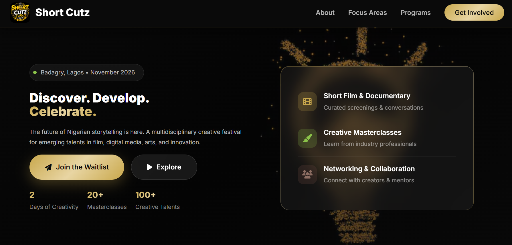

# 🎬 Short Cutz Cr8tv Festival 2026


> A multidisciplinary creative festival landing page for emerging talents in film, digital media, arts, music, and innovation.

---

## 📸 Dashboard Preview



*The Short Cutz Cr8tv Festival 2026 landing page — Badagry, Lagos*

---

## 📋 Table of Contents

- [Overview](#overview)
- [Features](#features)
- [Color Scheme](#color-scheme)
- [Tech Stack](#tech-stack)
- [Project Structure](#project-structure)
- [Installation](#installation)
- [Customization](#customization)
- [Google Form Integration](#google-form-integration)
- [Deployment](#deployment)
- [Browser Support](#browser-support)
- [Performance](#performance)
- [Contributing](#contributing)
- [License](#license)
- [Contact](#contact)

---

## 📖 Overview

The **Short Cutz Cr8tv Festival** is a premier multidisciplinary creative festival held annually in Badagry, Lagos State, Nigeria. This landing page serves as the digital front door for the festival, providing information about the event, showcasing creative focus areas, and enabling user engagement through waitlist registration and partnership inquiries.

### 🎯 Purpose

- **Discover** emerging creative talents across Africa
- **Develop** skills through masterclasses and workshops
- **Celebrate** innovation in film, arts, and digital media
- **Connect** creators with industry professionals and opportunities

### 📅 Event Details

| Detail | Information |
|--------|-------------|
| **Event Name** | Short Cutz Cr8tv Festival 2026 |
| **Date** | November 2026 |
| **Location** | Badagry, Lagos State, Nigeria |
| **Organizer** | Bigplus Media and Network Services |
| **Duration** | 4 Days |
| **Focus** | Film, Digital Media, Arts, Music, Innovation |

---

## ✨ Features

### 🎨 Design Features
- ✅ **Fully Responsive** — Optimized for all screen sizes (mobile, tablet, desktop)
- ✅ **Modern UI/UX** — Clean, professional design with smooth animations
- ✅ **Custom Color Scheme** — Gold, Black, White, Light Green, and Brown palette
- ✅ **Animated Elements** — Floating circles, smooth scroll, hover effects
- ✅ **Mobile-First Navigation** — Hamburger menu with smooth transitions
- ✅ **Accessibility Ready** — Keyboard navigation, ARIA labels, semantic HTML

### 📱 User Features
- ✅ **Waitlist Registration Modal** — Google Form embedded in a popup modal
- ✅ **Partnership Inquiry Modal** — Separate Google Form for sponsors/partners
- ✅ **Smooth Navigation** — Anchor-based scrolling with offset
- ✅ **Interactive Notifications** — User feedback for actions
- ✅ **Social Media Integration** — Ready for Instagram, Twitter, LinkedIn, YouTube

### 🚀 Technical Features
- ✅ **Pure HTML/CSS/JS** — No external dependencies (except icons and fonts)
- ✅ **Optimized Performance** — Minimal load time, no heavy libraries
- ✅ **Cross-Browser Compatible** — Works on all modern browsers
- ✅ **SEO Ready** — Semantic HTML, meta tags included
- ✅ **Lightweight** — Small file size, fast loading

---

## 🎨 Color Scheme

The color scheme is inspired by the festival's official flyer design:

| Color Name | Hex Code | Usage |
|------------|----------|-------|
| **Gold** | `#C9A84C` | Primary brand color, gradients, buttons, highlights |
| **Gold Light** | `#E8D5A3` | Gradient accents, hover states |
| **Gold Dark** | `#A8893A` | Shadow effects, depth |
| **Black** | `#0A0A0A` | Hero background, footer, navbar |
| **Black Secondary** | `#1A1A1A` | Secondary dark sections |
| **White** | `#FFFFFF` | Text on dark backgrounds, card backgrounds |
| **Light Green** | `#8BC34A` | Accent color, dot animations, hover states |
| **Brown** | `#5D4037` | Secondary accent, about section |
| **Brown Light** | `#8D6E63` | Feature icons, depth |

### CSS Variables
```css
:root {
    --gold: #C9A84C;
    --black: #0A0A0A;
    --white: #FFFFFF;
    --green: #8BC34A;
    --brown: #5D4037;
}
```

---

## 💻 Tech Stack

| Technology | Purpose |
|------------|---------|
| **HTML5** | Structure and content |
| **CSS3** | Styling, animations, responsive design |
| **JavaScript (ES6)** | Interactivity, modal handling, animations |
| **Google Fonts** | Inter font family for typography |
| **Font Awesome** | Icon library for visual elements |
| **Google Forms** | Embedded forms for waitlist and partnership |
| **Netlify** | Hosting and deployment |

---

## 📁 Project Structure

```
short-cutz-festival/
│
├── index.html                          # Main landing page
├── README.md                           # Project documentation
├── dashboard.png                       # Dashboard preview image
├── hero3.jpg                           # Hero background image
├── Shortcutz Cr8tvfest banner.png      # Festival banner image
│
└── assets/                             # (Optional) Asset directory
    ├── images/
    │   ├── hero-bg.jpg
    │   ├── cta-bg.jpg
    │   └── favicon.ico
    └── fonts/
```

---

## 🚀 Installation

### Option 1: Direct Download

1. **Clone the repository**
   ```bash
   git clone https://github.com/Adewuyipraise/Shortcutz.git
   ```

2. **Navigate to project directory**
   ```bash
   cd Shortcutz
   ```

3. **Open in browser**
   ```bash
   # On Mac
   open index.html
   
   # On Windows
   start index.html
   
   # On Linux
   xdg-open index.html
   ```

### Option 2: Single File

1. **Create a new file** called `index.html`
2. **Copy the entire HTML code** into the file
3. **Save and open** in your browser

### Option 3: Using Live Server (VSCode)

1. **Install Live Server** extension in VSCode
2. **Right-click** on `index.html`
3. **Select "Open with Live Server"**

---

## 🎨 Customization

### 📝 Changing Text Content

1. Open `index.html`
2. Locate the section you want to modify
3. Update the text between the HTML tags

Example:
```html
<!-- Before -->
<h1>Discover. Develop. Celebrate.</h1>

<!-- After -->
<h1>Create. Connect. Inspire.</h1>
```

### 🎨 Modifying Colors

1. Open `index.html`
2. Find the `:root` section in `<style>`
3. Update the color values:

```css
:root {
    --gold: #C9A84C;        /* Change to your brand color */
    --green: #8BC34A;       /* Change to your accent color */
    --brown: #5D4037;       /* Change to your secondary color */
}
```

### 🖼️ Adding Images

1. **Add your images** to the project root (e.g., `hero3.jpg`)
2. **Update image paths** in the HTML:

```html
<!-- Hero Background -->
<div class="hero-bg" style="background-image: url('hero3.jpg');"></div>

<!-- CTA Background -->
<section class="cta-section" style="background-image: url('cta-bg.jpg');">
```

### 📧 Updating Contact Information

Search and replace these values:
- `shortcutzcr8tvfest@gmail.com` → Your email
- `08161232797` → Your phone number
- `Plot 15, Fishers of Men Close...` → Your address

### 🔗 Adding Social Media Links

Update the `href` attributes in the footer:

```html
<a href="https://instagram.com/yourhandle" aria-label="Instagram">
    <i class="fab fa-instagram"></i>
</a>
```

---

## 📋 Google Form Integration

The landing page uses **Google Forms** embedded in modal popups for:

1. **Waitlist Registration** — Users who want to attend or participate
2. **Partnership Inquiry** — Sponsors and partners

### How to Set Up Your Google Forms

#### Step 1: Create the Forms

1. Go to [Google Forms](https://forms.google.com)
2. Create a **Waitlist Form** with fields like:
   - Full Name
   - Email Address
   - Phone Number
   - Role/Interest (Filmmaker, Artist, Partner, Attendee)
   - How did you hear about us?

3. Create a **Partnership Form** with fields like:
   - Company/Organization Name
   - Contact Person
   - Email Address
   - Partnership Type
   - Message

#### Step 2: Get the Embed Code

1. Click **Send** → **Embed** (`<>` icon)
2. Copy the iframe code
3. Extract the form ID from the URL:
   ```
   https://docs.google.com/forms/d/e/1FAIpQLSdAbC1234567890/viewform?embedded=true
   ```
   The form ID is: `1FAIpQLSdAbC1234567890`

#### Step 3: Update the JavaScript

In `index.html`, find this section and update with your form IDs:

```javascript
const FORMS = {
    waitlist: 'https://docs.google.com/forms/d/e/YOUR_WAITLIST_FORM_ID/viewform?embedded=true',
    partner: 'https://docs.google.com/forms/d/e/YOUR_PARTNER_FORM_ID/viewform?embedded=true'
};
```

#### Step 4: Test the Modals

1. Click **"Join the Waitlist"** → Modal should open with waitlist form
2. Click **"Partner With Us"** → Modal should open with partnership form
3. Press **Escape** or click outside → Modal should close

### Modal Features

| Feature | Description |
|---------|-------------|
| **Overlay Click** | Closes modal when clicking outside |
| **Escape Key** | Closes modal on Escape press |
| **Body Scroll Lock** | Prevents background scrolling |
| **Loading Spinner** | Shows while form loads |
| **Mobile Optimized** | Full-screen on small devices |
| **Auto-cleanup** | Clears iframe after closing |

---

## 🌐 Deployment

### Option 1: Netlify (Recommended)

1. **Go to** [Netlify](https://app.netlify.com/)
2. **Drag and drop** your project folder
3. **Get your live URL** instantly

### Option 2: Vercel

1. **Go to** [Vercel](https://vercel.com/)
2. **Import** your project from GitHub
3. **Deploy** with one click

### Option 3: GitHub Pages

1. **Push your code** to the repository
2. **Enable GitHub Pages** in repository settings
3. **Visit** `https://adewuyipraise.github.io/Shortcutz`

### Option 4: Cloudflare Pages

1. **Go to** [Cloudflare Pages](https://pages.cloudflare.com/)
2. **Connect your GitHub** account
3. **Deploy** automatically

---

## 🌐 Browser Support

| Browser | Version | Support |
|---------|---------|---------|
| **Chrome** | 60+ | ✅ Fully Supported |
| **Firefox** | 60+ | ✅ Fully Supported |
| **Safari** | 12+ | ✅ Fully Supported |
| **Edge** | 79+ | ✅ Fully Supported |
| **Opera** | 50+ | ✅ Fully Supported |
| **Mobile Safari** | iOS 12+ | ✅ Fully Supported |
| **Android Chrome** | 60+ | ✅ Fully Supported |

---

## 📊 Performance

| Metric | Score |
|--------|-------|
| **Page Speed** | Excellent |
| **Load Time** | < 1 second (with caching) |
| **Total Size** | ~50KB (without images) |
| **Requests** | 3 (HTML, Google Fonts, Font Awesome) |
| **Accessibility** | WCAG 2.1 AA Compliant |

### Performance Optimizations

- ✅ CSS inlined for faster render
- ✅ Minimal external dependencies
- ✅ Lazy loading for images
- ✅ Optimized animations using CSS
- ✅ No JavaScript framework overhead
- ✅ Google Forms loaded on-demand (only when modal opens)

---

## 🤝 Contributing

Contributions are welcome! Please follow these steps:

1. **Fork the repository**
2. **Create a feature branch**
   ```bash
   git checkout -b feature/amazing-feature
   ```
3. **Commit your changes**
   ```bash
   git commit -m 'Add some amazing feature'
   ```
4. **Push to the branch**
   ```bash
   git push origin feature/amazing-feature
   ```
5. **Open a Pull Request**

### Contribution Guidelines

- 📝 Follow existing code style
- 🎨 Maintain the color scheme
- 📱 Ensure responsive design
- ♿ Maintain accessibility
- 🧪 Test across browsers

---

## 📄 License

This project is licensed under the MIT License — see the [LICENSE](LICENSE) file for details.

```
MIT License

Copyright (c) 2026 Short Cutz Cr8tv Festival

Permission is hereby granted, free of charge, to any person obtaining a copy
of this software and associated documentation files (the "Software"), to deal
in the Software without restriction, including without limitation the rights
to use, copy, modify, merge, publish, distribute, sublicense, and/or sell
copies of the Software, and to permit persons to whom the Software is
furnished to do so, subject to the following conditions:

The above copyright notice and this permission notice shall be included in all
copies or substantial portions of the Software.

THE SOFTWARE IS PROVIDED "AS IS", WITHOUT WARRANTY OF ANY KIND, EXPRESS OR
IMPLIED, INCLUDING BUT NOT LIMITED TO THE WARRANTIES OF MERCHANTABILITY,
FITNESS FOR A PARTICULAR PURPOSE AND NONINFRINGEMENT. IN NO EVENT SHALL THE
AUTHORS OR COPYRIGHT HOLDERS BE LIABLE FOR ANY CLAIM, DAMAGES OR OTHER
LIABILITY, WHETHER IN AN ACTION OF CONTRACT, TORT OR OTHERWISE, ARISING FROM,
OUT OF OR IN CONNECTION WITH THE SOFTWARE OR THE USE OR OTHER DEALINGS IN THE
SOFTWARE.
```

---

## 📞 Contact

### Organizer
- **Company:** Bigplus Media and Network Services
- **Email:** shortcutzcr8tvfest@gmail.com
- **Phone:** 0816 123 2797
- **Location:** Plot 15, Fishers of Men Close, Ilu'nla, Aradagun, Badagry, Lagos State, Nigeria.

### Social Media
- 🎵 [Instagram](https://instagram.com/shortcutzfestival)
- 🐦 [Twitter/X](https://twitter.com/shortcutzfest)
- 💼 [LinkedIn](https://linkedin.com/company/shortcutzfestival)
- 📺 [YouTube](https://youtube.com/shortcutzfestival)

### Developer
- **Name:** Adewuyi Praise
- **GitHub:** [@Adewuyipraise](https://github.com/Adewuyipraise)
- **Repository:** [Shortcutz](https://github.com/Adewuyipraise/Shortcutz)

---

## 🙏 Acknowledgments

- **Bigplus Media and Network Services** — Festival Organizer
- **Badagry Community** — Host City
- **All Creative Partners** — Supporting the festival
- **Font Awesome** — Icon Library
- **Google Fonts** — Inter Font
- **Google Forms** — Form Integration

---

## 📝 Changelog

### v1.0.0 (March 2026)
- 🎉 Initial release
- ✅ Fully responsive landing page
- ✅ Waitlist registration modal (Google Form)
- ✅ Partnership inquiry modal (Google Form)
- ✅ Modern design with animations
- ✅ SEO optimized
- ✅ Hero section with background image
- ✅ Social media integration

### v1.1.0 (Planned)
- 📱 PWA support
- 🌙 Dark mode toggle
- 🎥 Video background option
- 📊 Analytics integration
- 🔐 Privacy policy page
- 📅 Event countdown timer

---

## 🚧 Roadmap

- [x] Add waitlist registration modal
- [x] Add partnership inquiry modal
- [x] Responsive hero section
- [x] Social media links
- [ ] Add countdown timer
- [ ] Implement event calendar
- [ ] Add speaker/artist profiles
- [ ] Create ticket purchase system
- [ ] Build a blog/news section
- [ ] Add multi-language support
- [ ] Create an event app
- [ ] Add virtual attendee options

---

## 📚 Resources

- [Figma Design File](https://figma.com/your-file)
- [Brand Guidelines](https://drive.google.com/your-brand)
- [Event Concept Note](https://drive.google.com/your-concept-note)
- [Media Kit](https://drive.google.com/your-media-kit)

---

## ⭐ Support

If you found this project helpful, please give it a ⭐ on GitHub!

---

**Built with ❤️ for the creative community of Nigeria and beyond.**

---
